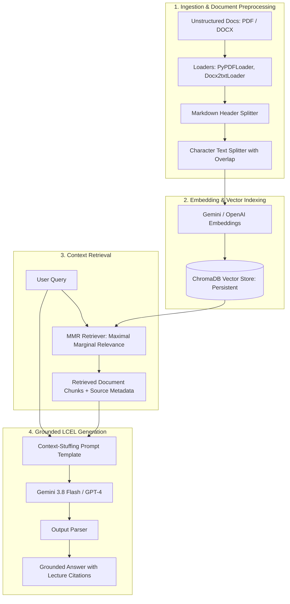

# Production RAG Pipeline (LangChain & ChromaDB)

[](https://www.python.org/)
[](https://www.langchain.com/)
[-blueviolet.svg)](https://aistudio.google.com/)
[](https://www.trychroma.com/)
[](LICENSE)

An end-to-end, production-grade **Retrieval-Augmented Generation (RAG)** pipeline and **LangChain Expression Language (LCEL)** application. This project demonstrates how to eliminate model hallucinations and deliver grounded, citation-backed answers from unstructured enterprise documents (PDF & DOCX) using free Google Gemini or OpenAI.

---

## 🏗️ System Architecture



---

## 🌟 Key Features

1. **Free Tier AI Powered**: Natively supports free Google Gemini API (`gemini-3.8-flash` & `gemini-embedding-001`) with zero subscription cost, as well as OpenAI.
2. **Multi-Format Ingestion**: Supports both native multi-page PDFs (`PyPDFLoader`) and formatted Word documents (`Docx2txtLoader`).
3. **Metadata-Preserving Chunking**: Uses `MarkdownHeaderTextSplitter` to retain structural course & lecture headings inside chunk metadata, followed by `CharacterTextSplitter` with overlap.
4. **Maximal Marginal Relevance (MMR) Retrieval**: Prevents repetitive context stuffing by balancing query relevance with candidate diversity (`fetch_k=10`, `k=3`, `lambda_mult=0.7`).
5. **Hallucination Prevention with Source Citations**: Prompt engineering forces strict adherence to retrieved context only and appends source citations (`Resources: *Lecture Title*`).
6. **Modern LCEL Design**: Built with declarative LangChain Expression Language (`|`), supporting `invoke`, batching, and streaming.
7. **Vectorstore Management**: Demonstrates full CRUD operations (add, update, delete) on persistent Chroma collections.

---

## 📂 Repository Structure

```
.
├── 05_LangChain_RAG.ipynb                            # Complete Interactive RAG Pipeline & Guide
├── Introduction_to_Data_and_Data_Science.pdf         # Raw PDF Document Source
├── Introduction_to_Data_and_Data_Science_2.docx      # Formatted DOCX Document Source
├── requirements.txt                                  # Environment dependencies
├── .env.example                                      # Environment variable template
├── .gitignore                                        # Safeguards keys, caches & virtual environments
└── README.md                                         # Project Documentation & Architecture
```

---

## ⚡ Quick Start

### 1. Clone & Set Up Virtual Environment
```bash
git clone https://github.com/your-username/enterprise-rag-langchain-chroma.git
cd enterprise-rag-langchain-chroma

python -m venv venv
# On Windows:
venv\Scripts\activate
# On Linux/macOS:
source venv/bin/activate
```

### 2. Install Dependencies
```bash
pip install -r requirements.txt
```

### 3. Configure API Key
Create a `.env` file in the root directory:
```env
# Free Google Gemini Key (from https://aistudio.google.com/)
GOOGLE_API_KEY="your_api_key_here"

# (Optional) If using OpenAI instead
OPENAI_API_KEY="sk-your-openai-key-here"
```

### 4. Run the Pipeline
Launch Jupyter to explore and execute the RAG pipeline:
```bash
jupyter notebook 05_LangChain_RAG.ipynb
```
Select the **Python (AI Engineer venv)** kernel.

---

## 📊 Sample Output

```text
Query: "What software do data scientists use?"

=== Grounded RAG Output ===
Data scientists use a variety of software tools. R and Python are the two most popular tools 
across all columns as they can manipulate data and are integrated within multiple data science 
platforms. For big data and heavy computational tasks, Hadoop distributes workloads across 
clusters. For business intelligence visualizations, top software includes Power BI, SAS, 
Qlik, and especially Tableau.

Resources: Programming Languages & Software Employed in Data Science - All the Tools You Need
```

---

## 📜 License
This project is licensed under the MIT License.
